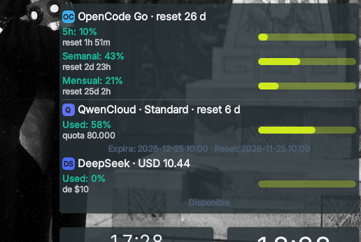
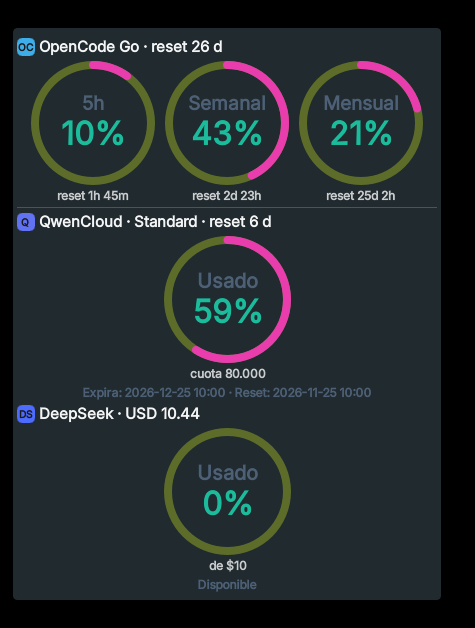
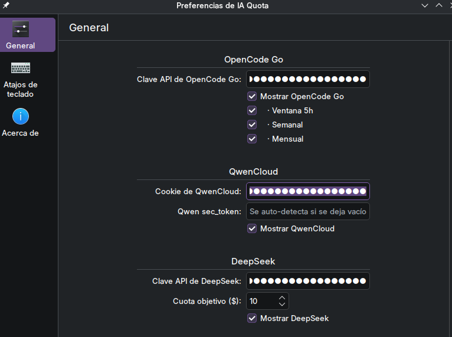
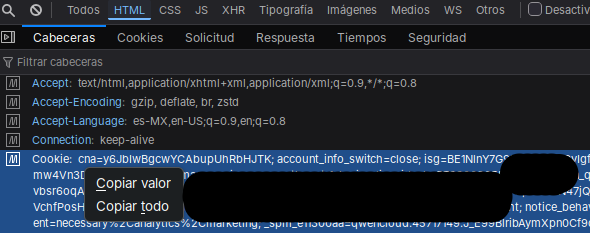

# Widget simple de cuotas de IA para KDE Plasma 6

Un widget simple que muestra tus cuotas de IA en el escritorio de KDE Plasma 6.
También lee QwenCloud, DeepSeek, OpenAI y Anthropic, así que sirve como monitor
general.



Modo círculos:



Barras o círculos, diseño adaptable, fondo según el tema y 5 idiomas.

## Filosofía

Mantenerlo simple.

## Instalación

```bash
kpackagetool6 -t Plasma/Applet -i org.cesar.iaquota.plasmoid
```

Clic derecho en el escritorio → _Añadir al panel_ → **IA Quota**.

## Configuración

Clic derecho en el widget → _Configurar widget_ y pega tus claves:



- **OpenCode Go / DeepSeek / OpenAI / Anthropic**: su API key.
- **QwenCloud**: la cookie de sesión. En Firefox abre `home.qwencloud.com`,
  pulsa F12 → _Red_, recarga, elige la petición principal → _Cabeceras_ →
  clic derecho en `Cookie` → _Copiar valor_ y pégala.



Sin credenciales el widget solo pide configurarlas. El fondo sigue el toggle
estándar de Plasma (modo edición) y el contraste del texto se adapta solo.

_Versión en inglés: [README.md](README.md)_

## Autor

Cesar Guzman — GPL-2.0+
