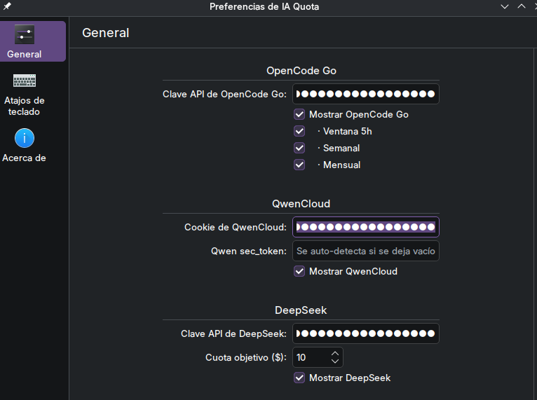

# Simple AI Quota Widget for KDE Plasma 6

A simple widget that shows your AI quotas on the KDE Plasma 6 desktop.
It also reads QwenCloud, DeepSeek, OpenAI and Anthropic, so it works as a
general AI-quota monitor.


Bars or circles, responsive layout, theme-aware background, 5 languages.

## Install

```bash
kpackagetool6 -t Plasma/Applet -i org.cesar.iaquota.plasmoid
```

Right-click the desktop → _Add to panel_ → **IA Quota**.

## Setup

Right-click the widget → _Configure widget_ and paste your keys:



- **OpenCode Go / DeepSeek / OpenAI / Anthropic**: your API key.
- **QwenCloud**: your session cookie. In Firefox, open
  `home.qwencloud.com`, press F12 → _Network_, reload, pick the main request →
  _Headers_ → right-click `Cookie` → _Copy value_, then paste it.


Without credentials the widget just asks you to configure them. The background
follows the standard Plasma toggle (edit mode) and text contrast adapts itself.

_Spanish version: [README.es.md](README.es.md)_

## Author

Cesar Guzman — GPL-2.0+
