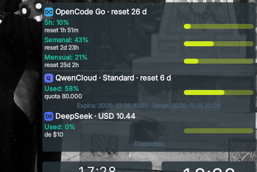

# IA Quota

Desktop widget for KDE Plasma 6 showing your AI quotas.



Shows OpenCode Go (5h, weekly, monthly), QwenCloud, DeepSeek
(balance over a configurable target), OpenAI and Anthropic,
as bars or circles, with automatic refresh.

## Install

```bash
kpackagetool6 -i .
cp icon.svg ~/.local/share/icons/hicolor/scalable/apps/org.cesar.iaquota.svg
kbuildsycoca6
```

Then right-click the desktop → *Add to panel* → **IA Quota**.

## Setup

Right-click the widget → *Configure widget* and paste your keys:


- **OpenCode Go / DeepSeek / OpenAI / Anthropic**: your API key.
- **QwenCloud**: your session cookie. In Firefox, open
  `home.qwencloud.com`, press F12 → *Network* tab, reload,
  pick the main request → *Headers* → right-click
  `Cookie` → *Copy value* and paste it in the field.


Without credentials the widget just asks you to configure them.
The background follows the standard Plasma toggle (edit mode),
and the text adapts on its own.

*Versión en español: [README.es.md](README.es.md)*

## Author

Cesar Guzman — GPL-2.0+
