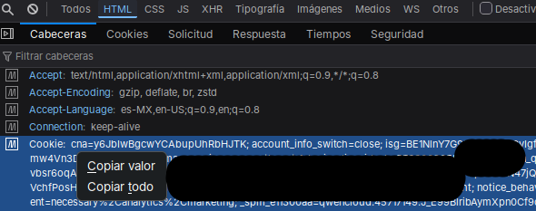

# OpenCode Quota

Quota widget for KDE Plasma 6, built around **OpenCode Go** (5-hour, weekly and
monthly windows). It also reads QwenCloud, DeepSeek, OpenAI and Anthropic, so it
works as a general AI-quota monitor.


Bars or circles, responsive layout, theme-aware background, 5 languages.

## Install

```bash
kpackagetool6 -t Plasma/Applet -i org.cesar.iaquota.plasmoid
```

Right-click the desktop → *Add to panel* → **IA Quota**.

## Setup

Right-click the widget → *Configure widget* and paste your keys:


- **OpenCode Go / DeepSeek / OpenAI / Anthropic**: your API key.
- **QwenCloud**: your session cookie. In Firefox, open
  `home.qwencloud.com`, press F12 → *Network*, reload, pick the main request →
  *Headers* → right-click `Cookie` → *Copy value*, then paste it.



Without credentials the widget just asks you to configure them. The background
follows the standard Plasma toggle (edit mode) and text contrast adapts itself.

*Spanish version: [README.es.md](README.es.md)*

## Author

Cesar Guzman — GPL-2.0+
